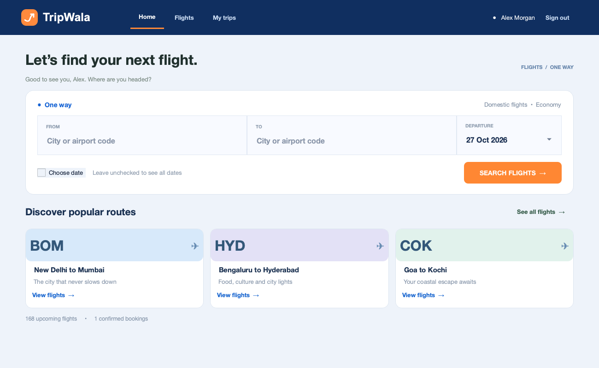
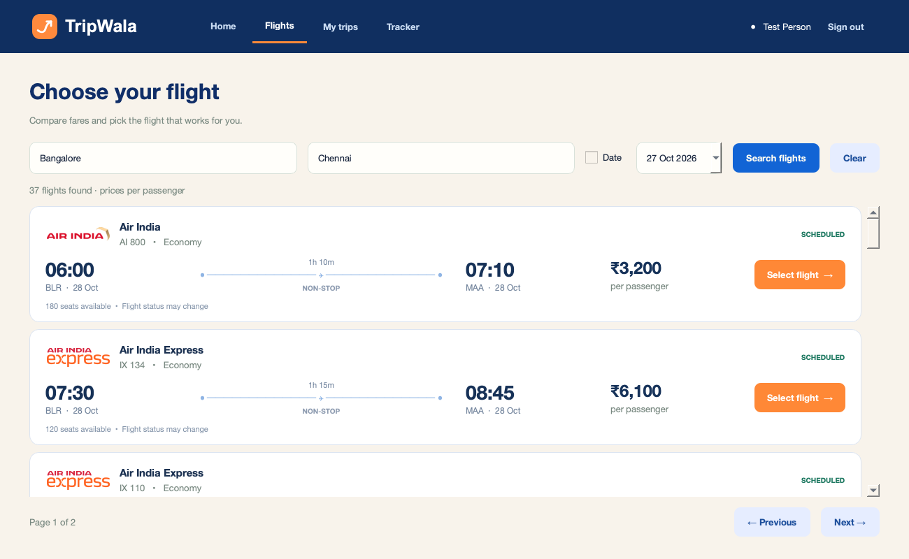
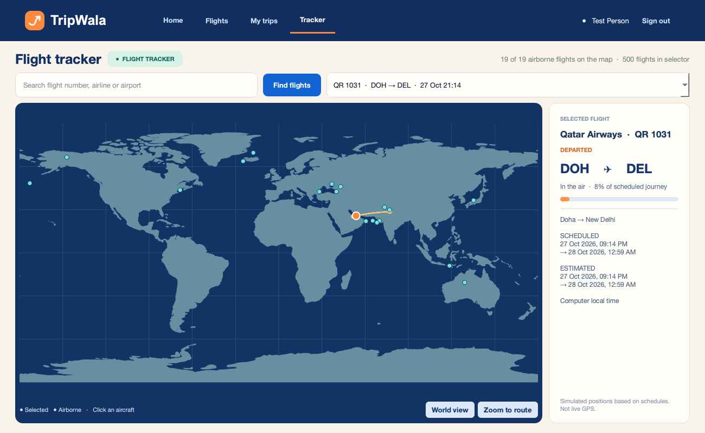
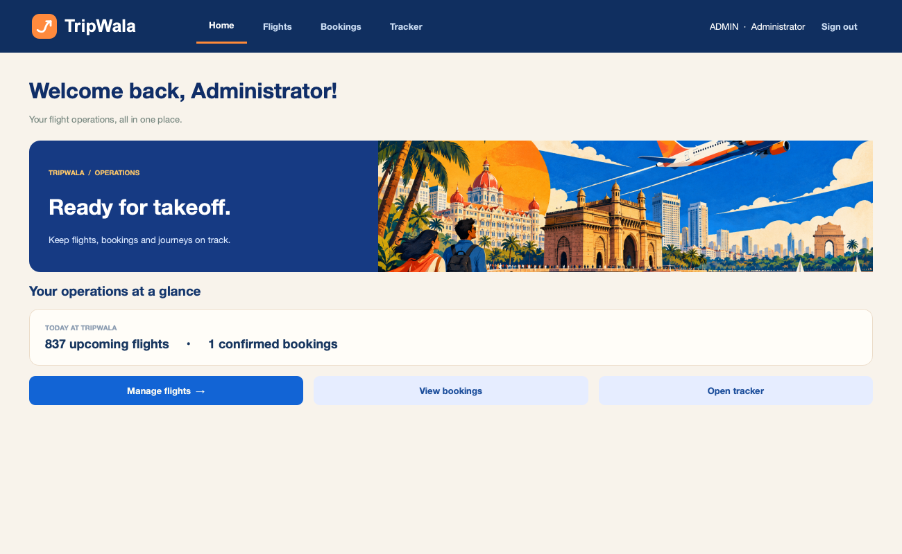

# TripWala ✈

TripWala is an offline, standalone desktop Flight Management System for a class 12 project. It uses Python, PySide6 for the native interface, and a local MySQL database. There is no browser, web server, external API or internet connection in the app.

## Preview









Screenshots show illustrative sample data.

## What it does

- Register and sign in as a traveller; passwords are salted and hashed.
- Search flights by origin, destination and optional departure date (including common city aliases such as Bangalore/Bengaluru), enter traveller and contact details, review the fare, book seats, see bookings and cancel future bookings.
- See all currently airborne simulated flights on an offline world map, select one by clicking its marker or searching, and zoom to its route. Positions follow an illustrative great-circle path and use simulated schedules and delays, not live GPS or real airline flight paths. Airport coordinates cover over 4,000 airports; flights without known coordinates show timing and status without a map marker.
- Sign in as an administrator to add flights, set delays, cancel flights and view all bookings.
- A local timer updates flight statuses every 2 seconds while the app is open. Flight times advance with the real clock; reopening the app catches statuses up.
- The simulator maintains seven calendar days of fictional domestic and international flights, with approximate distance-based flight durations for the expanded network, and checks every 30 seconds for flights within two hours of departure. Each eligible flight gets one 12% chance of a 15–60 minute delay. Delays shift simulated departure and arrival. Admin-set delays (including zero) override automatic delays; cancelled flights remain cancelled.
- Airline names and logos make the interface familiar, but all schedules, flight numbers and prices are fictional and are not airline-provided data. All flight times use the computer’s local time, including international flights; the app does not calculate airport time zones. Existing flights keep their original schedules; older generic airline labels are updated while booking and flight IDs remain unchanged. The simulation runs only while the app is open; missed delay rolls are not replayed after reopening.

## Requirements

- Python 3.10 or newer, with a version supported by PySide6 and MySQL Connector/Python.
- A locally installed and running MySQL server (tested locally with MySQL 9.6). Remember its username and password; the account needs permission to create a database and tables on first run.
- PySide6 and mysql-connector-python, listed in `requirements.txt`. Installing dependencies may require internet; running the app does not.

## Run

Open a terminal in this folder:

```bash
python -m venv .venv
```

Activate it with `source .venv/bin/activate` on macOS/Linux or `.venv\Scripts\activate` on Windows, then:

```bash
python -m pip install -r requirements.txt
python main.py
```

Enter your local MySQL host (`localhost`), port (`3306`), username and password in the connection window. The connection dialog does not save credentials. For automatic local connection, create a `mysql.local.json` file in the project folder with `host`, `port`, `user` and `password` fields. This optional file is ignored by Git and stores the password as plaintext; restrict access to it and do not share it. The app creates `flight_management` and its tables on first connection. If your MySQL account cannot create databases, ask the MySQL administrator to grant the required permissions.

First-run administrator login:

- Email: `admin@flightdesk.local`
- Password: `Admin@123`

These are demonstration credentials. The application currently has no password-change screen; use this account only for a local classroom demo. Register a separate account for the traveller interface. The demo account is created only when the users table is empty.

## Project structure

- `main.py` — application entry point.
- `flightdesk/ui.py` — PySide6 login, traveller, administrator and tracker screens.
- `flightdesk/db.py` — MySQL schema, queries, bookings and flight simulation.
- `flightdesk/geo.py` — offline airport lookup and great-circle calculations.
- `flightdesk/assets/` — bundled map, airport coordinates, illustrations and airline logos.

## Database design

- `users`: login details and role.
- `flights`: route, schedule, seat capacity, price, delay and status.
- `booking_passengers` and `booking_contacts`: traveller names and contact details linked to a booking.
- `bookings`: passenger reservations, with `user_id` referencing `users(id)` and `flight_id` referencing `flights(id)` through foreign keys.
- `simulator_days`, `simulator_network_days`, and `simulator_domestic_v2_days`: record generated schedule dates to prevent duplicates.

Relationships: one user can have many bookings; one flight can have many bookings; each booking can have many passenger names and one contact record. The passenger and contact tables reference `bookings(id)` with foreign keys.

Bookings are inserted in a transaction that locks the flight record and checks available seats. Cancelling a booking keeps its history and releases its seats. Cancelling a flight retains reservations and shows the flight's cancelled status alongside them. No real payments, ticket issuance or live flight data are involved.

## Notes for a school project report

**Aim:** build an offline flight management application in Python with a relational MySQL database.

**Modules:** authentication, flight search, booking and cancellation, administrator operations, and a clock-driven flight tracker. PySide6 provides the desktop interface; MySQL Connector/Python connects it to MySQL.

**Booking flow:** select a flight → enter traveller and contact details → review the fare → confirm. The database locks the flight record, checks the remaining capacity, and saves the booking and associated details in one transaction. No payment is processed.

**Simulation:** the application periodically generates fictional routes, assigns delays, and updates flight statuses using the computer's clock. The map interpolates each airborne aircraft along an approximate great-circle route. It does not access live airline feeds.

**Testing ideas:** register and log in; search Bangalore to Chennai; book multiple travellers; verify that capacity decreases; cancel and confirm capacity returns; set an admin delay and check the tracker; close and reopen the app. Use your own screenshots and observed results in the report.

## Troubleshooting

- **Connection refused:** start the local MySQL server and check host and port.
- **Access denied:** check the MySQL username, password and database creation privileges.
- **No flights:** clear the search or add flights through the admin account; seed flights eventually move into the past.
- **Dependencies fail to install:** use a Python version supported by current PySide6 wheels, such as Python 3.12 or 3.13.

## Data and artwork credits

The offline world map uses [Natural Earth 1:110m land data](https://www.naturalearthdata.com/about/terms-of-use/), which is public domain.

Airport coordinates are bundled from the [OurAirports open-data project](https://ourairports.com/data/); the app does not contact it at runtime.

Airline logos are bundled from Wikimedia Commons for this educational demonstration: [IndiGo](https://commons.wikimedia.org/wiki/File:IndiGo_Airlines_logo.svg), [Air India](https://commons.wikimedia.org/wiki/File:Air_India_2023.svg), [Air India Express](https://commons.wikimedia.org/wiki/File:Air_India_Express_logo.svg), [Emirates](https://commons.wikimedia.org/wiki/File:Emirates_Logo.svg), [Singapore Airlines](https://commons.wikimedia.org/wiki/File:Singapore_Airlines_Logo.svg), [Qatar Airways](https://commons.wikimedia.org/wiki/File:Qatar_Airways_logo.svg), [British Airways](https://commons.wikimedia.org/wiki/File:British_Airways_1997_wordmark.svg), [American Airlines](https://commons.wikimedia.org/wiki/File:American_Airlines_wordmark_(2013).svg), [ANA](https://commons.wikimedia.org/wiki/File:All_Nippon_Airways_Logo.svg), [SpiceJet](https://commons.wikimedia.org/wiki/File:New_SpiceJet_Logo.png), and [Vistara](https://commons.wikimedia.org/wiki/File:Vistara_Logo.svg). Logos remain the property of their respective owners; the project is not affiliated with these airlines.
